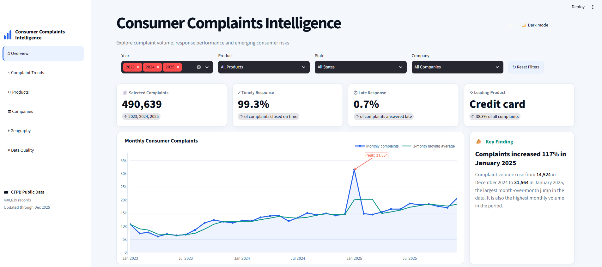
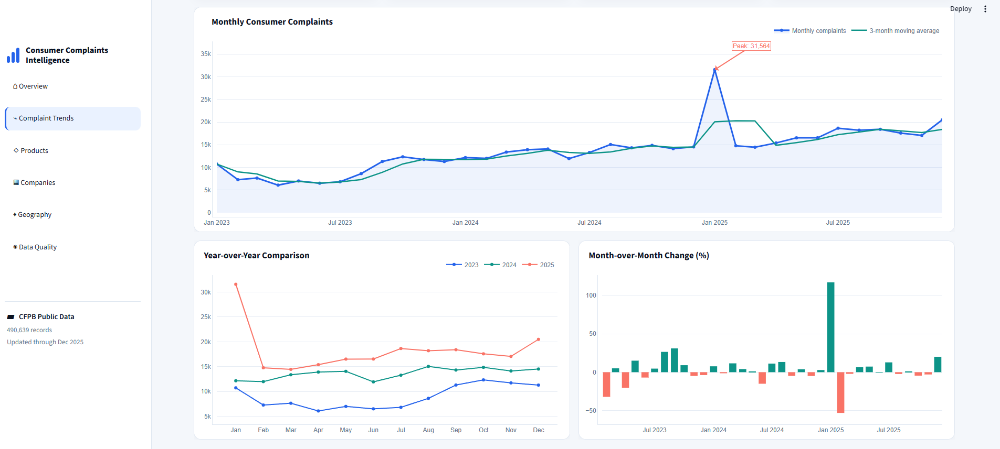
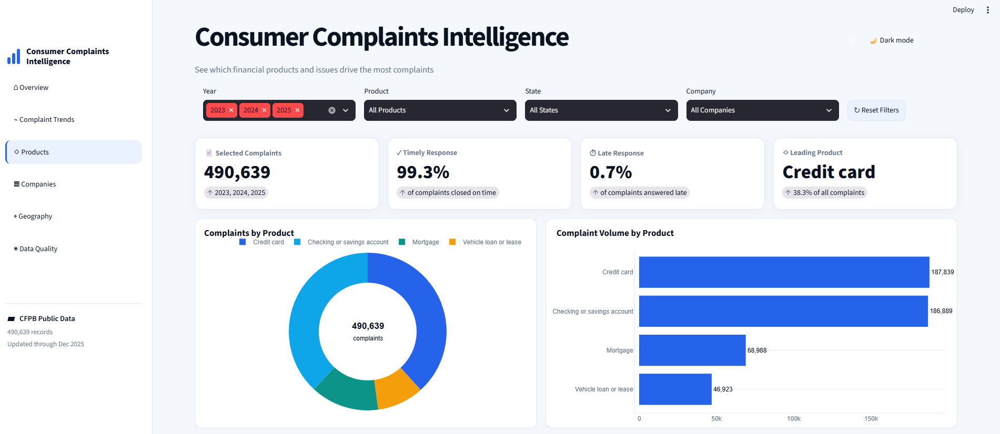
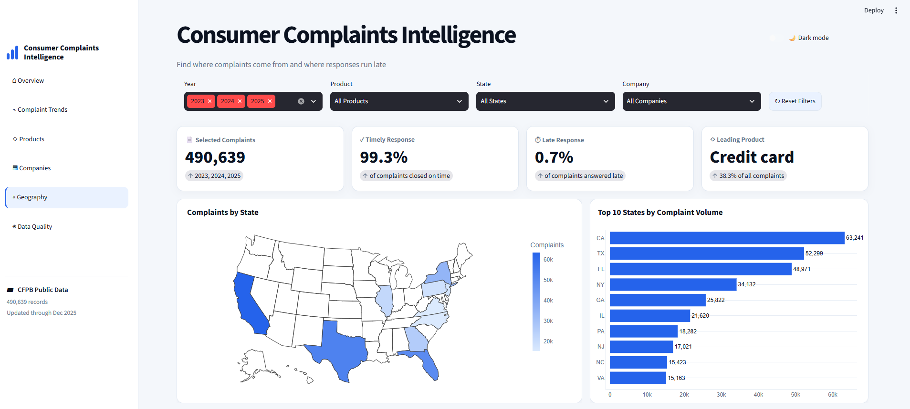
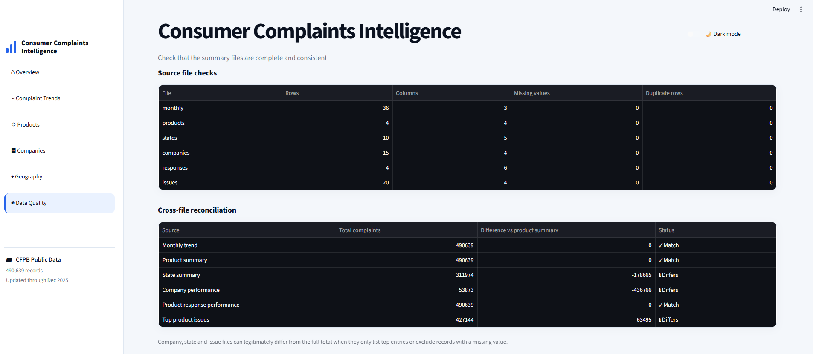
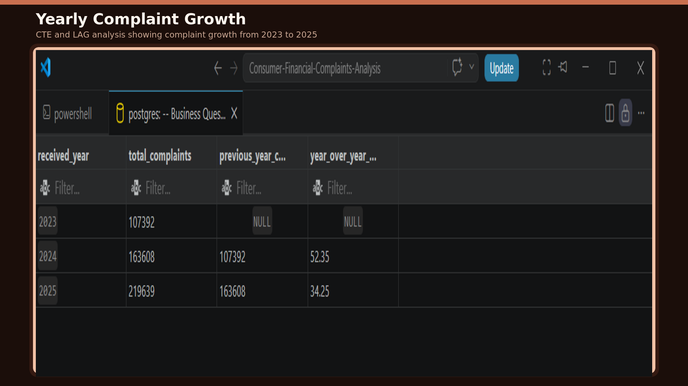
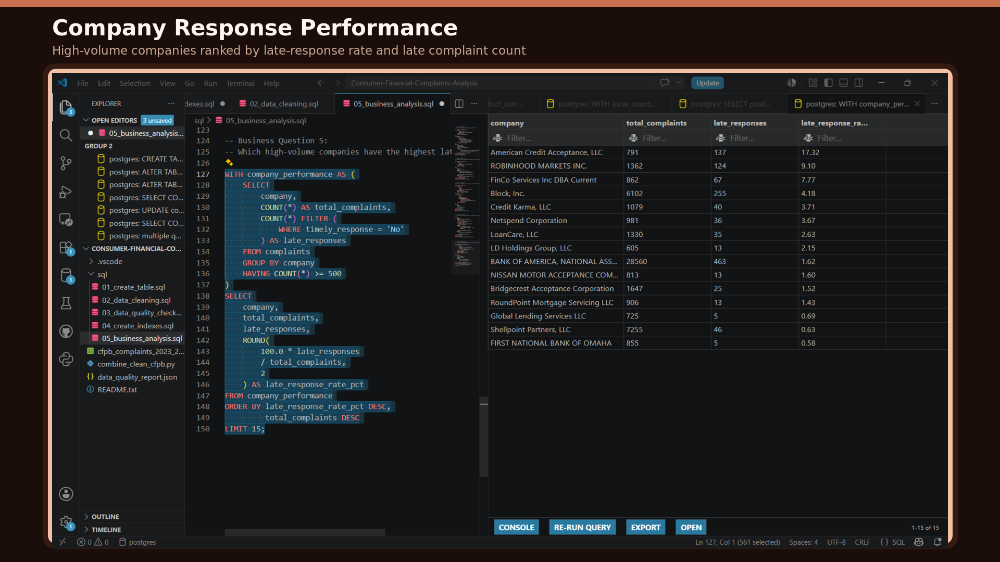
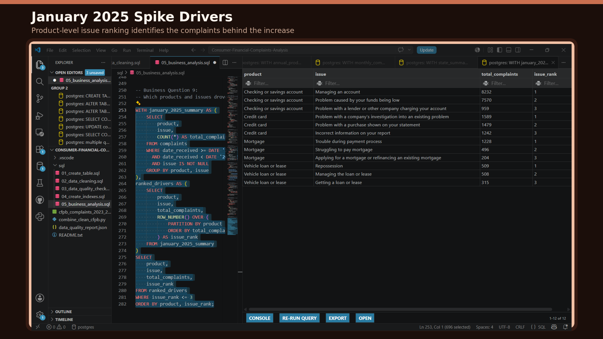

# Consumer Financial Complaints Intelligence

> **End-to-end complaint analytics using public CFPB data, Python, PostgreSQL, SQL, and Streamlit to identify trends, response performance, geographic concentration, and unusual changes in consumer complaints.**



## Executive Summary

This project analyzes **490,639 consumer complaints** received between **January 2023 and December 2025** across four financial products:

- Credit cards
- Checking or savings accounts
- Mortgages
- Vehicle loans or leases

The workflow combines Python data preparation, PostgreSQL analytics, data-quality validation, and an interactive Streamlit dashboard.

## Business Problem

Financial institutions and consumer-protection teams need to know where complaint volumes are increasing, which products generate the most complaints, how company response performance varies, and where geographic concentration is highest.

The project turns a large complaint-level dataset into a reproducible analytical workflow and decision-support dashboard.

## Key Questions

- How has complaint volume changed over time?
- Which financial products account for the largest share of complaints?
- Which issues occur most frequently within each product?
- Which companies receive the most complaints?
- Which companies have higher late-response rates?
- Which states have the highest complaint volumes?
- What drove the January 2025 complaint spike?
- Are dashboard summaries consistent with the source data?

## Analytical Workflow

**Public CFPB Data → Python Cleaning → PostgreSQL → SQL Analysis → Validation → Summary Tables → Streamlit Dashboard**

## Technology Stack

| Area | Tools |
|---|---|
| Data source | CFPB Consumer Complaint Database |
| Data cleaning | Python, pandas |
| Database | PostgreSQL |
| SQL | CTEs, joins, conditional aggregation, window functions |
| Advanced analysis | RANK, ROW_NUMBER, moving averages, YoY analysis |
| Visualization | Streamlit, Plotly |
| Version control | Git, GitHub |

## Architecture

```text
CFPB public data
      │
      ▼
Python cleaning & validation
      │
      ▼
PostgreSQL analytical database
      │
      ├── Business analysis SQL
      ├── Data-quality checks
      └── Performance indexes
      │
      ▼
Processed analytical summaries
      │
      ▼
Streamlit + Plotly dashboard
```

## Dataset

**Source:** [CFPB Consumer Complaint Database](https://www.consumerfinance.gov/data-research/consumer-complaints/)

| Metric | Coverage |
|---|---:|
| Date range | 2023-01-01 to 2025-12-31 |
| Records analyzed | 490,639 |
| Financial products | 4 |
| Granularity | Complaint-level public records |

The dataset contains complaint dates, products, issues, companies, states, response status, and timely-response information.

> **Data availability:** The complete cleaned complaint-level CSV is approximately 143 MB and is not committed because it exceeds GitHub's individual file-size limit. The repository contains the reproducible cleaning script, quality report, SQL pipeline, and smaller processed dashboard summaries.

## Data Cleaning & Validation

The Python workflow:

1. Combines multiple CFPB extracts.
2. Standardizes column names using `snake_case`.
3. Requires a parseable received date and derives year, month number, month label, and year-month fields.
4. Retains valid complaints when the sent-to-company date is missing or malformed, leaving the sent date and elapsed days blank.
5. Removes duplicate complaint IDs, keeping the first valid occurrence in sorted input-file order.
6. Reports missing/invalid sent dates and sent-before-received cases separately.
7. Standardizes whitespace and tracks blank values by column.
8. Exports the cleaned dataset and a JSON quality report.

Data-quality checks are retained as separate project artifacts rather than hidden inside the analysis.

**Evidence and reproducibility**
- [Cleaning script](combine_clean_cfpb.py) — inspect the row-handling and transformation rules.
- [Recorded data-quality report](data_quality_report.json) — see the counts recorded for the committed run.
- [Data-quality methodology](docs/data_quality_methodology.md) — review cleaning decisions, reproduction steps and known limitations.
- [Initial SQL checks](sql/03_data_quality_checks.sql) and [extended SQL checks](sql/06_extended_data_quality_checks.sql) — run checks for blanks, date consistency, derived fields, response categories and total reconciliation.

The JSON report records a run; it is not a guarantee that future source extracts will produce identical results. The cleaning script now skips rows only when the complaint ID is missing or the received date cannot be parsed. It retains complaints with missing or malformed sent-to-company dates and records those cases in the quality report. See the methodology and regression tests for the exact rules.

## SQL Analysis

The PostgreSQL layer demonstrates:

- Common table expressions
- Joins and aggregation
- Conditional aggregation
- Window functions
- `RANK()` and `ROW_NUMBER()`
- Three-month moving averages
- Year-over-year comparisons
- Data-quality and reconciliation checks
- Indexing for common analytical fields

Business analyses include product concentration, company response performance, state rankings, monthly trends, and investigation of unusual complaint spikes.

## Python & Dashboard Layer

Python and pandas transform analytical outputs into reusable dashboard summaries:

- `monthly_trend.csv`
- `product_summary.csv`
- `state_summary.csv`
- `company_performance.csv`
- `product_response_performance.csv`
- `top_product_issues.csv`

Streamlit provides filters and navigation, while Plotly provides interactive visualizations.

## Key Findings

- **Credit cards represented 38.3% of selected complaints**, making them the largest product category.
- **99.3% of complaints received a timely company response**, while approximately 0.7% were answered late.
- Monthly complaints increased from **14,524 in December 2024 to 31,564 in January 2025**, an increase of approximately **117%**.
- **January 2025** recorded the highest monthly complaint volume in the analysis period.
- **California** recorded the largest state-level complaint volume in the dashboard dataset.

These findings describe patterns in submitted complaints; they should not be interpreted as proof of company wrongdoing.

**How to inspect the evidence**
- [Year-over-year growth and product share](sql/05_business_analysis.sql) — business questions 1–2.
- [Issue rankings and response performance](sql/05_business_analysis.sql) — business questions 3–5.
- [Monthly trend and three-month moving average](sql/05_business_analysis.sql) — business question 7.
- [January 2025 spike breakdown](sql/05_business_analysis.sql) — business question 9.
- [Data cleaning and validation notes](docs/data_quality_methodology.md) — explains how to rerun the checks and interpret their results.
- [Cleaning regression tests](tests/test_combine_clean_cfpb.py) — covers missing/invalid sent dates, invalid received dates, duplicate IDs, and output schema.

For the January 2025 change, the comparison from 14,524 complaints in December 2024 to 31,564 in January 2025 is approximately a 117.3% increase. This is a descriptive month-to-month change, not proof of a specific cause. The product/issue breakdown helps identify where the increase appears; additional investigation would be needed to establish why.

## Dashboard

### Complaint Overview


### Complaint Trends


### Product Analysis


### Geographic Analysis


### Data-Quality Validation


## SQL Evidence

### Yearly Complaint Growth


### Company Response Performance


### January 2025 Spike Drivers


## Project Structure

```text
Consumer-Financial-Complaints-Analysis/
├── app.py
├── combine_clean_cfpb.py
├── data_quality_report.json
├── requirements.txt
├── data/
│   ├── README.md
│   └── processed/
├── docs/
│   └── business_case.md
├── sql/
│   ├── 01_create_table.sql
│   ├── 02_data_cleaning.sql
│   ├── 03_data_quality_checks.sql
│   ├── 04_create_indexes.sql
│   └── 05_business_analysis.sql
├── screenshots/
└── README.md
```

## Run Locally

```bash
git clone https://github.com/austinechi1/Consumer-Financial-Complaints-Analysis.git
cd Consumer-Financial-Complaints-Analysis
python -m venv .venv
```

Windows PowerShell:

```powershell
.venv\Scripts\Activate.ps1
python -m pip install -r requirements.txt
python -m streamlit run app.py
```

## Future Improvements

- Automated CFPB data refresh
- Direct PostgreSQL-backed dashboard
- Statistical anomaly detection
- Controlled natural-language analytics
- Additional financial products and refreshed data

## Author

**Nwachukwu Austine**  
Data Analyst | SQL | Python | PostgreSQL

[GitHub](https://github.com/austinechi1) · [Portfolio](https://austinechi1.github.io/)

## Disclaimer

This project is for educational and portfolio purposes. The dataset is public CFPB data. Findings describe submitted complaints and do not represent all consumer experiences or verified company wrongdoing.
